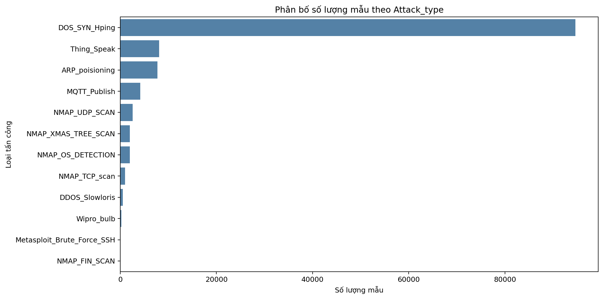
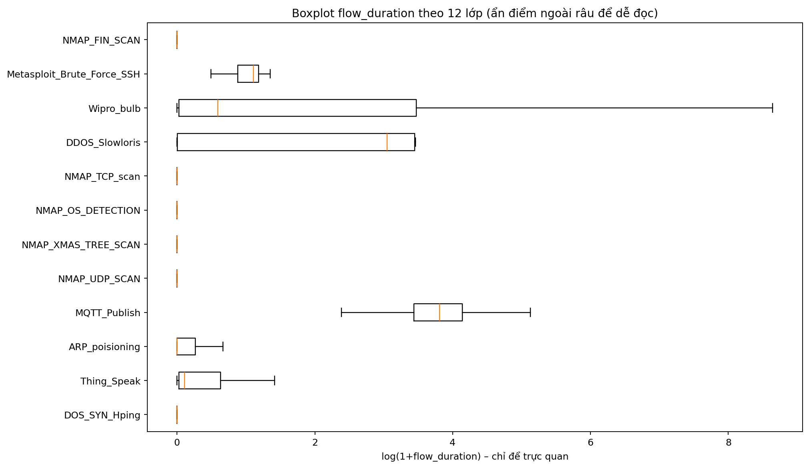
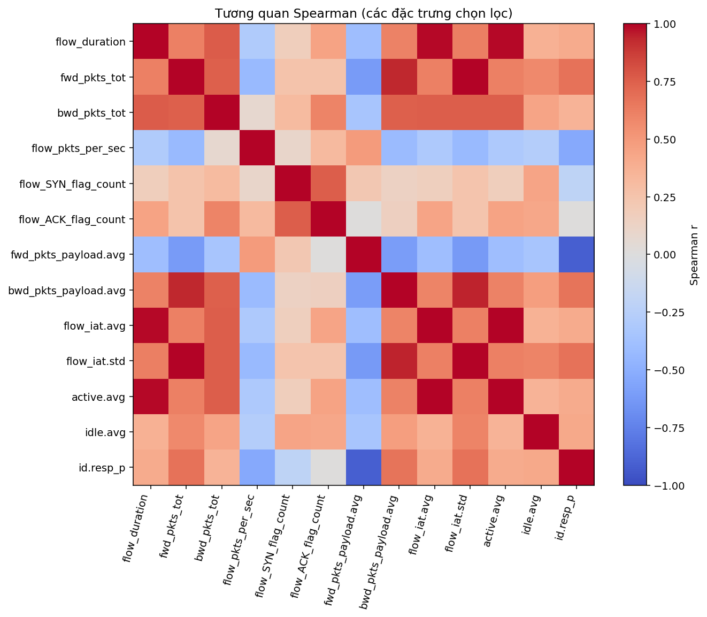
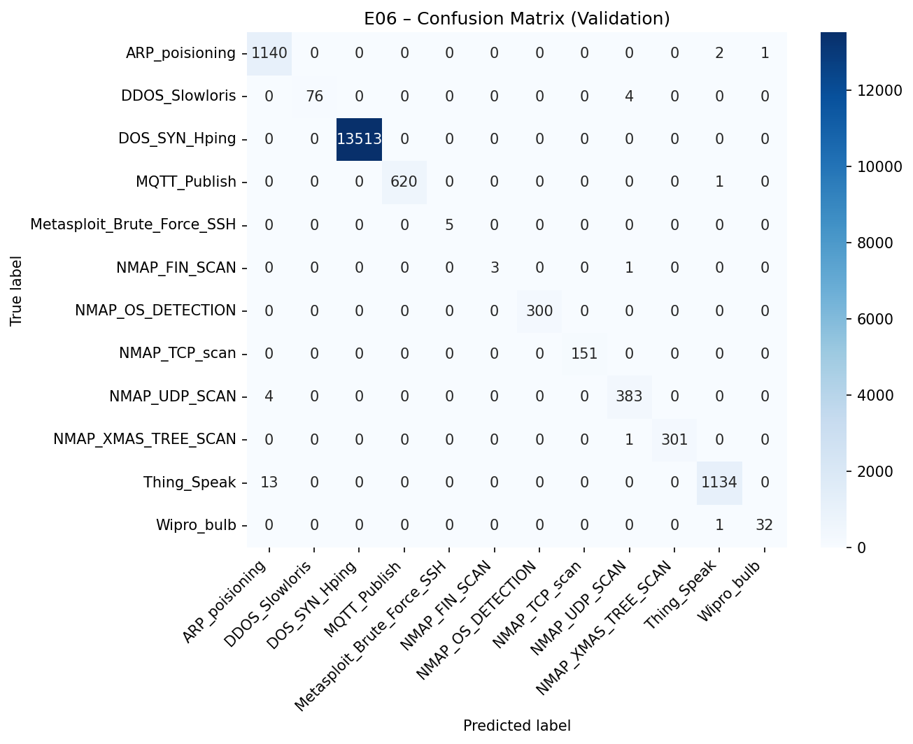

# PHÁT HIỆN NORMAL/ATTACK HOẶC PHÂN LOẠI KIỂU TẤN CÔNG IoT

<div align="center">

Machine Learning for IoT Network Intrusion Detection

[](https://www.python.org/)
[](https://scikit-learn.org/)
[](https://jupyter.org/)
[](#)
[](https://doi.org/10.24432/C5P338)

Trường Đại học Sài Gòn — Khoa Công nghệ Thông tin

[Dataset](#dataset) · [Workflow](#machine-learning-workflow) · [Mô hình](#machine-learning-models) · [Kết quả](#experimental-results) · [Cài đặt](#installation--usage)

</div>

---

## Mục lục

- [Tổng quan đồ án](#tổng-quan-đồ-án)
- [Dataset](#dataset)
- [Machine Learning Workflow](#machine-learning-workflow)
- [Exploratory Data Analysis](#exploratory-data-analysis)
- [Data Preprocessing](#data-preprocessing)
- [Machine Learning Models](#machine-learning-models)
- [Experimental Setup](#experimental-setup)
- [Experimental Results](#experimental-results)
- [Error Analysis](#error-analysis)
- [Cấu trúc dự án](#cấu-trúc-dự-án)
- [Installation & Usage](#installation--usage)
- [Kết luận nghiên cứu](#kết-luận-nghiên-cứu)
- [Future Work](#future-work)
- [Thành viên](#thành-viên)
- [Liên kết nhóm](#liên-kết-nhóm)
- [Tài liệu tham khảo](#tài-liệu-tham-khảo)

## Tổng quan đồ án

Đồ án nghiên cứu bài toán phân loại lưu lượng mạng IoT thành 12 lớp, gồm lưu lượng bình thường và 9 loại tấn công. Mỗi bản ghi trong RT-IoT2022 được mô tả bằng đặc trưng giao tiếp mạng; biến mục tiêu là Attack_type.

Đây là bài toán học máy trên dữ liệu đã thu thập, không phải hệ thống phát hiện thời gian thực hoặc ứng dụng triển khai trên mạng. Nhóm so sánh ba thuật toán tham chiếu—Decision Tree, Random Forest và MLP—bằng Stratified 3-Fold Cross-Validation, Validation và Test.

Random Forest với class_weight='balanced_subsample' được chọn làm mô hình cuối. Mô hình đạt Accuracy 99.88%, Macro-F1 97.47% trên 17.687 mẫu Test. Accuracy cao không thể hiện mọi lớp hiếm đều được nhận diện hoàn hảo; Macro-F1 và Macro-Recall được xem cùng nhau để đánh giá tác động của mất cân bằng dữ liệu.

## Dataset

| Thuộc tính | Giá trị |
|---|---:|
| Tên bộ dữ liệu | RT-IoT2022 |
| Nguồn | UCI Machine Learning Repository |
| DOI | [10.24432/C5P338](https://doi.org/10.24432/C5P338) |
| Bản ghi gốc | 123.117 |
| Bản ghi sau làm sạch | 117.909 |
| Số cột gốc | 85 |
| Số đặc trưng đầu vào sau tiền xử lý | 82 |
| Số đặc trưng số | 80 |
| Số đặc trưng phân loại | 2: proto, service |
| Biến mục tiêu | Attack_type |
| Số lớp | 12 |
| Lớp chiếm đa số | DOS_SYN_Hping — 94.659 bản ghi |
| Lớp hiếm nhất | NMAP_FIN_SCAN — 28 bản ghi |

<div align="center">
  
  <p><em>Phân bố lớp trong bộ dữ liệu RT-IoT2022.</em></p>
</div>

### Cấu trúc nhãn

ARP_poisioning, DDOS_Slowloris, DOS_SYN_Hping, MQTT_Publish, Metasploit_Brute_Force_SSH, NMAP_FIN_SCAN, NMAP_OS_DETECTION, NMAP_TCP_scan, NMAP_UDP_SCAN, NMAP_XMAS_TREE_SCAN, Thing_Speak, Wipro_bulb.

### Phân chia dữ liệu

| Tập | Tỷ lệ | Số lượng |
|---|---:|---:|
| Train | 70% | 82.536 |
| Validation | 15% | 17.686 |
| Test | 15% | 17.687 |

Phân chia sử dụng random_state=42 và Stratified Sampling. Các phép audit trong workspace xác nhận không có bản ghi trùng hash đặc trưng giữa Train, Validation và Test.

## Machine Learning Workflow

```mermaid
flowchart LR
    A[RT-IoT2022] --> B[Exploratory Data Analysis]
    B --> C[Data Cleaning]
    C --> D[Stratified Data Splitting]
    D --> E[Feature Preprocessing trong Pipeline]
    E --> F[Model Training]
    F --> G[Stratified 3-Fold CV]
    G --> H[Validation Evaluation]
    H --> I[Model Selection]
    I --> J[Final Fit: Train + Validation]
    J --> K[Test Evaluation]
```



Scaler, imputer hoặc encoder chỉ được fit trong phạm vi dữ liệu huấn luyện tương ứng của từng fold hoặc lần huấn luyện cuối. Validation và Test không tham gia tuning, chuẩn hóa hoặc chọn đặc trưng.

## Exploratory Data Analysis

Các phân tích chính đã được thực hiện trong notebook và lưu dưới final_IoT/sample_project/result/eda/:

- Phân bố lớp và mức độ mất cân bằng.
- Kiểm tra missing values và infinite values.
- Tìm bản ghi trùng và xung đột nhãn.
- Phân tích outlier bằng IQR và boxplot.
- Spearman Correlation Heatmap.
- Phân phối 12 lớp theo đặc trưng số và phân loại.
- So sánh thống kê flow_duration giữa các lớp.

<div align="center">
  
  <p><em>Boxplot phân phối <code>flow_duration</code> theo lớp lưu lượng.</em></p>
</div>

<div align="center">
  
  <p><em>Ma trận tương quan Spearman giữa các đặc trưng số.</em></p>
</div>

## Data Preprocessing

| Bước | Quy trình |
|---|---|
| Loại cột export | Loại Unnamed: 0 |
| Loại bản ghi trùng | Loại 5.195 bản ghi trùng chính xác |
| Xử lý xung đột nhãn | Loại 13 bản ghi trong 6 nhóm đặc trưng xung đột |
| Loại đặc trưng hằng | Loại bwd_URG_flag_count |
| Kết quả | Còn 117.909 bản ghi và 82 đặc trưng đầu vào |

Không thực hiện imputation hay resampling ở bước làm sạch cơ sở.

| Mô hình | Xử lý đặc trưng số | Xử lý đặc trưng phân loại | Biến thể đặc biệt |
|---|---|---|---|
| Decision Tree | Giữ nguyên | One-Hot Encoding khi có trong pipeline | Không scaling |
| Random Forest baseline | Giữ nguyên | One-Hot Encoding | n_estimators=100 |
| Random Forest cải tiến | Giữ nguyên | One-Hot Encoding | Trọng số cân bằng, lọc tương quan hoặc loại cổng |
| MLP baseline | StandardScaler | OneHotEncoder | One hidden layer, 64 neurons |
| MLP NoScaler | Không scaling | OneHotEncoder | Đo tác động của thiếu chuẩn hóa |
| MLP Signed-Log | Signed-log rồi StandardScaler | OneHotEncoder | Kiến trúc 64 hoặc 128-64 neurons |

## Machine Learning Models

### Decision Tree

Decision Tree là mô hình tham chiếu dễ diễn giải và phản ánh trực tiếp các ranh giới quyết định trên đặc trưng mạng.

- Baseline: DecisionTreeClassifier, Gini, không giới hạn độ sâu.
- Các biến thể: max_depth=12, min_samples_leaf=3, kết hợp độ sâu và kích thước lá, class_weight='balanced'.
- Ưu điểm: huấn luyện nhanh, luật dễ trực quan.
- Hạn chế: nhạy với nhiễu và có dấu hiệu overfitting khi không giới hạn độ sâu.

### Random Forest

Random Forest xây dựng 100 cây và kết hợp kết quả để giảm phương sai so với Decision Tree.

- Baseline gần mặc định, n_estimators=100, random_state=42.
- Biến thể: class_weight='balanced_subsample', lọc đặc trưng tương quan cao (|r|≥0.98), loại id.orig_p và id.resp_p.
- Ưu điểm: ổn định, mạnh trên dữ liệu bảng và dẫn đầu trong các baseline.
- Hạn chế: chi phí huấn luyện cao hơn và cải thiện cân bằng lớp có thể rất nhỏ.

### MLP

MLP baseline dùng một hidden layer gồm 64 neurons, ReLU, Adam, alpha=0.0001, learning_rate_init=0.001, batch_size=512, max_iter=60.

- Các biến thể thử: bỏ scaler, signed-log, hai hidden layers 128-64, tăng alpha=0.01.
- StandardScaler là quan trọng: thí nghiệm không scaling giảm mạnh Macro-F1.
- Mô hình 60 iterations chưa hội tụ hoàn toàn trong nhiều cấu hình; kết quả chỉ phản ánh giới hạn thử nghiệm của đồ án.

## Experimental Setup

- 3 baseline và 11 biến thể cải tiến.
- Stratified 3-Fold Cross-Validation trên tập Train.
- Stratified Sampling cho Train/Validation/Test với seed 42.
- Validation hỗ trợ so sánh và lựa chọn cấu hình.
- Test không được dùng để tuning hoặc lựa chọn mô hình.
- Sau khi chọn mô hình, huấn luyện lại bằng Train + Validation rồi đánh giá Test.

| Nhóm chỉ số | Vai trò |
|---|---|
| Accuracy | Tổng tỷ lệ dự đoán đúng |
| Macro-Precision | Precision trung bình không trọng số theo lớp |
| Macro-Recall | Khả năng bắt đúng các mẫu trong từng lớp |
| Macro-F1 | Cân bằng Precision và Recall cho từng lớp |
| Weighted-F1 | F1 có trọng số theo support |

Macro-F1 được ưu tiên vì dữ liệu mất cân bằng mạnh. Macro-Recall giúp đánh giá khả năng nhận diện từng lớp thay vì chỉ nhìn tỷ lệ Accuracy tổng thể.

## Experimental Results

### Baseline Cross-Validation

| Mô hình | CV Macro-F1 trung bình |
|---|---:|
| Decision Tree | 0.9452 |
| Random Forest | 0.9652 |
| MLP | 0.9459 |

### Baseline Validation

| Mô hình | Validation Macro-F1 |
|---|---:|
| Decision Tree | 0.9746 |
| Random Forest | 0.9810 |
| MLP | 0.9659 |

### Tổng hợp 14 thí nghiệm

> Giá trị CV/Validation được lấy từ notebook, workbook Experiment_Log.xlsx và Best_Model_Test_Evaluation.xlsx. E06 xuất hiện trong đợt Exp1 và Exp4 nhưng là cùng một cấu hình, vì vậy được ghi một lần duy nhất trong bảng 14 thí nghiệm.

| Thí nghiệm | Mô hình / cấu hình chính | CV Macro-F1 | Validation Macro-F1 |
|---|---|---:|---:|
| E01 | Decision Tree, baseline không giới hạn độ sâu | 0.9452 | 0.9746 |
| E02 | Decision Tree, max_depth=12 | 0.9509 | 0.9641 |
| E03 | Decision Tree, min_samples_leaf=3 | 0.9418 | 0.9723 |
| E04 | Decision Tree, max_depth=12 + min_samples_leaf=3 | 0.9464 | 0.9732 |
| E05 | Random Forest, 100 cây, baseline | 0.9652 | 0.9810 |
| E06 | Random Forest, balanced_subsample | 0.9661 | 0.9808 |
| E07 | Decision Tree, class_weight='balanced' | 0.9613 | 0.9794 |
| E08 | Random Forest, balanced + lọc tương quan (|r|≥0.98) | 0.9658 | 0.9750 |
| E09 | Random Forest, balanced + bỏ id.orig_p, id.resp_p | 0.9586 | 0.9744 |
| E10 | MLP 64, StandardScaler, baseline | 0.9459 | 0.9659 |
| E11 | MLP 64, không scaler | 0.6522 | 0.6272 |
| E12 | MLP 64, signed-log + StandardScaler | 0.9495 | 0.9678 |
| E13 | MLP 128-64, signed-log + StandardScaler | 0.9493 | 0.9695 |
| E14 | MLP 128-64, signed-log + StandardScaler, alpha=0.01 | 0.9499 | 0.9613 |

### Final Test Results

| Mô hình | Test Accuracy | Test Macro-F1 | Dự đoán sai |
|---|---:|---:|---:|
| Decision Tree baseline | 0.9983 | 0.9738 | 30 |
| Random Forest baseline | 0.9986 | 0.9745 | 24 |
| MLP baseline | 0.9952 | 0.9569 | 85 |
| Random Forest balanced_subsample | 0.9988 | 0.9747 | 21 |

Mô hình được chọn: E06 — Random Forest với class_weight='balanced_subsample'

- Test Accuracy: 99.88%
- Test Macro-Precision: 99.69%
- Test Macro-Recall: 96.09%
- Test Macro-F1: 97.47%
- Dự đoán đúng: 17.666/17.687 mẫu
- Dự đoán sai: 21 mẫu
- 3-fold CV Macro-F1: 0.9661 ± 0.0063
- Validation Macro-F1: 0.9808
- Validation Macro-Recall: 0.9700

<div align="center">
  
  <p><em>Ma trận nhầm lẫn trên Validation của mô hình Random Forest E06.</em></p>
</div>

Ma trận nhầm lẫn Test đầy đủ nằm trong [Best_Model_Test_Evaluation.xlsx](./final_IoT/sample_project/result/exps/best%20model/Best_Model_Test_Evaluation.xlsx).

### Per-Class Test F1

| Lớp | Precision | Recall | F1 | Support |
|---|---:|---:|---:|---:|
| ARP_poisioning | 0.9887 | 0.9974 | 0.9930 | 1.143 |
| DDOS_Slowloris | 0.9868 | 0.9494 | 0.9677 | 79 |
| DOS_SYN_Hping | 1.0000 | 1.0000 | 1.0000 | 13.514 |
| MQTT_Publish | 1.0000 | 1.0000 | 1.0000 | 622 |
| Metasploit_Brute_Force_SSH | 1.0000 | 0.6000 | 0.7500 | 5 |
| NMAP_FIN_SCAN | 1.0000 | 1.0000 | 1.0000 | 4 |
| NMAP_OS_DETECTION | 1.0000 | 1.0000 | 1.0000 | 300 |
| NMAP_TCP_scan | 1.0000 | 1.0000 | 1.0000 | 150 |
| NMAP_UDP_SCAN | 0.9897 | 0.9948 | 0.9923 | 388 |
| NMAP_XMAS_TREE_SCAN | 1.0000 | 0.9967 | 0.9983 | 301 |
| Thing_Speak | 0.9974 | 0.9922 | 0.9948 | 1.148 |
| Wipro_bulb | 1.0000 | 1.0000 | 1.0000 | 33 |

## Error Analysis

- Thing_Speak và ARP_poisioning xuất hiện cùng các nhầm lẫn nhỏ trong nhiều mô hình.
- Metasploit_Brute_Force_SSH có chỉ 5 mẫu trong Test; E06 nhận đúng 3/5 mẫu, Recall = 0.60 và F1 = 0.75.
- NMAP_FIN_SCAN chỉ có 4 mẫu trong Test, nên các kết quả hoàn hảo cần được diễn giải thận trọng.
- Wipro_bulb có 33 mẫu Test và mô hình được chọn nhận diện tốt trên tập này.
- Decision Tree baseline cho thấy hiện tượng cây không giới hạn độ sâu và khoảng cách tổng quát hóa cần kiểm tra.
- MLP baseline chưa hội tụ hoàn toàn do giới hạn 60 iterations; các mẫu training loss cho thấy quá trình học vẫn có biến động.
- MLP phụ thuộc mạnh vào StandardScaler: bỏ scaler làm CV Macro-F1 giảm từ 0.9459 xuống 0.6522.
- Accuracy 99.88% chủ yếu phản ánh hiệu quả nhận diện lớp chiếm ưu thế. Macro-F1 và per-class metrics vẫn là căn cứ quan trọng.
- Chênh Test Macro-F1 giữa Random Forest baseline và Random Forest balanced_subsample chỉ khoảng 0.0002; không có bằng chứng thống kê cho một cải thiện có ý nghĩa thực sự.

## Cấu trúc dự án

```text
final_IoT/
├── IoT_classfication/
│   ├── BÁO CÁO CUỐI KỲ MÔN MÁY HỌC.docx
│   ├── Draw.pptx
│   ├── POSTER.pptx
│   ├── SLIDE.pdf
│   ├── eda/
│   ├── exps/
│   └── preprocessing/
└── sample_project/
    ├── data/
    │   ├── raw/
    │   │   └── RT_IOT2022.csv
    │   └── splitted data/
    │       ├── train.csv
    │       ├── validation.csv
    │       ├── test.csv
    │       └── RT_IoT2022_clean.csv
    ├── project/
    │   ├── eda/
    │   ├── preprocessing/
    │   ├── baseline/
    │   └── exps/
    └── result/
        ├── eda/
        ├── preprocessing/
        ├── baseline/
        └── exps/
```

- project/: notebook nguồn cho EDA, preprocessing, baseline và biến thể.
- result/: notebook đã chạy, HTML execution log, biểu đồ, Excel metrics, cấu hình JSON và dữ liệu preprocessing.
- IoT_classfication/: báo cáo, slide, poster và tài liệu tổng hợp nhóm.

## Installation & Usage

### 1. Clone repository

```powershell
git clone https://github.com/dungluu277/SGU26K2_MayHoc_DCT124C3_Nhom4_RT-IoT2022.git
cd SGU26K2_MayHoc_DCT124C3_Nhom4_RT-IoT2022
```

### 2. Tạo môi trường Python

```powershell
py -m venv .venv
.\\.venv\\Scripts\\Activate.ps1
python -m pip install --upgrade pip
python -m pip install jupyter notebook pandas numpy matplotlib seaborn scikit-learn openpyxl
```

Repository hiện không cung cấp requirements chung trong thư mục cuối kỳ; các thư viện trên tương ứng với pipeline trong notebook.

### 3. Kiểm tra dữ liệu

Dữ liệu gốc và dữ liệu đã chia đã có trong:

```text
final_IoT/sample_project/data/raw/RT_IOT2022.csv
final_IoT/sample_project/data/splitted data/train.csv
final_IoT/sample_project/data/splitted data/validation.csv
final_IoT/sample_project/data/splitted data/test.csv
```

Nếu chạy notebook tại thư mục khác, kiểm tra lại đường dẫn tuyệt đối/tương đối trong từng cell.

### 4. Chạy notebook

```powershell
jupyter notebook
```

Chạy theo thứ tự tham chiếu:

1. final_IoT/sample_project/project/eda/01_Data_Overview.ipynb
2. final_IoT/sample_project/project/eda/02_Data_Distribution.ipynb
3. final_IoT/sample_project/project/eda/03_Outliers_Correlation.ipynb
4. final_IoT/sample_project/project/eda/04_Feature_Target_Analysis.ipynb
5. final_IoT/sample_project/project/preprocessing/preprocessing_basic.ipynb
6. Các notebook baseline trong final_IoT/sample_project/project/baseline/
7. Các notebook biến thể trong final_IoT/sample_project/project/exps/

Kết quả thực nghiệm có thể xem trực tiếp tại final_IoT/sample_project/result/; workbook tổng hợp chính là result/exps/Experiment_Log.xlsx và result/exps/Best_Model_Test_Evaluation.xlsx.

## Kết luận nghiên cứu

Random Forest là thuật toán phù hợp nhất trong ba baseline. Mô hình được chọn có chiến lược cân bằng lớp balanced_subsample, đạt CV Macro-F1 cao nhất nhóm (0.9661) và gần cao nhất trên Validation; mô hình cuối đạt Macro-F1 97.47% trên Test.

Các giới hạn cần ghi nhận:

- Dữ liệu mất cân bằng mạnh; lớp hiếm có support rất thấp.
- Kết quả dựa trên một dataset tĩnh, chưa chứng minh hiệu quả với lưu lượng hoặc thiết bị chưa từng xuất hiện.
- Chia dữ liệu theo bản ghi, chưa theo phiên tấn công hay thời gian.
- Chưa thử nghiệm trên hệ thống IoT thực tế.
- MLP chỉ được chạy tối đa 60 iterations và chưa được tuning đầy đủ.
- Chênh giá trị giữa các cấu hình RF là nhỏ; chưa có kiểm định thống kê khẳng định khác biệt.

## Future Work

Các hướng dưới đây là đề xuất nghiên cứu, chưa phải chức năng đã hoàn thành:

- Hyperparameter tuning mở rộng cho Random Forest và MLP.
- SMOTE hoặc resampling chỉ nằm trong từng fold Train để giảm leakage.
- Đánh giá theo phiên, thiết bị, địa chỉ hoặc thời gian thay vì bản ghi độc lập.
- Feature engineering theo ngữ cảnh giao thức và luồng mạng.
- Thử XGBoost, LightGBM hoặc CatBoost.
- Tăng vòng lặp, early stopping và tìm kiến trúc MLP tối ưu.
- Kiểm tra trên dataset độc lập.
- Đánh giá triển khai Edge/IoT trong tương lai.

## Thành viên

| Thành viên | Vai trò trong đồ án |
|---|---|
| Lưu Lương Mạnh Dũng | Nhóm trưởng; tổng hợp thí nghiệm, so sánh mô hình, báo cáo, slide và poster |
| Nguyễn Xuân Hậu Thành | Thực hiện thí nghiệm Decision Tree |
| Nguyễn Thành Đại | Thực hiện thí nghiệm MLP |
| Lê Đăng Tiến | Thực hiện thí nghiệm Random Forest |

| Thành viên | MSSV |
|---|---:|
| Lưu Lương Mạnh Dũng | 3124411053 |
| Nguyễn Thành Đại | 3124411061 |
| Lê Đăng Tiến | 3124411311 |
| Nguyễn Xuân Hậu Thành | 3124411278 |

## Liên kết nhóm

- [Drive minh chứng chạy thực nghiệm](https://drive.google.com/drive/folders/1dZ6BlL46RooJ-FnvvnCHD0tSNdVDdFsu?usp=drive_link)
- [Google Docs - Báo cáo đồ án](https://docs.google.com/document/d/10iYZxoF4KZjpvoaexhOCCcAlMnjlhGNXDbLvKk89F0g/edit?usp=sharing)
- [Google Sheets - Phân công công việc](https://docs.google.com/spreadsheets/d/1anzJYDVXp3kiWoB7VXHo2T5IlKezRM_1/edit?usp=sharing&ouid=114781297964179421782&rtpof=true&sd=true)
- [Slide Canva](https://canva.link/1ovkbaqvdt6njs7)

## Tài liệu tham khảo

1. UCI Machine Learning Repository — *RT-IoT2022*. DOI: [10.24432/C5P338](https://doi.org/10.24432/C5P338).
2. Scikit-learn documentation — Decision Tree, Random Forest, MLPClassifier và Cross-Validation.
3. Tài liệu báo cáo cuối kỳ: [BÁO CÁO CUỐI KỲ MÔN MÁY HỌC.docx](./final_IoT/IoT_classfication/BÁO%20CÁO%20CUỐI%20KỲ%20MÔN%20MÁY%20HỌC.docx).
4. Workbook thực nghiệm: [Experiment_Log.xlsx](./final_IoT/sample_project/result/exps/Experiment_Log.xlsx).
5. Kết quả mô hình cuối: [Best_Model_Test_Evaluation.xlsx](./final_IoT/sample_project/result/exps/best%20model/Best_Model_Test_Evaluation.xlsx).
